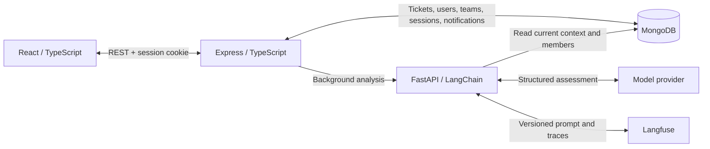

# Paperdesk

Paperdesk manages internal support tickets and identifies the teams and people needed to handle them. It combines a React interface, an Express API, and a Python coordination agent that reads the organization's team responsibilities and current ticket evidence.

A payroll export failure, for example, can involve Business Applications to investigate the defect and Finance because payroll processing is blocked. Paperdesk's [evaluation fixture](experiments/tickets.csv) includes this case and its expected teams and stakeholders.

## Ticket workflows

| Role | Capabilities |
| --- | --- |
| Employee | Submit tickets, edit or delete their own open tickets, and read tickets that involve them as stakeholders. |
| Support | Read all tickets and update priority, status, and assignee. |
| Admin | Manage all tickets, users, roles, account status, teams, responsibilities, and memberships. |

The backend enforces [ticket permissions](backend/src/modules/tickets/ticketPermissions.ts). Stakeholder access grants visibility without granting editing rights.

- **[Ticket board](frontend/src/pages/TicketsPage.tsx):** pagination and filters for status, priority, category, and involvement; support and admins can also filter by assignee.
- **[Team directory](frontend/src/components/TeamMembersDialog.tsx):** editable responsibilities and membership management, including a picker that retains selections across pages.
- **[Coordination](frontend/src/components/CoordinationPanel.tsx):** saved incident summaries, relevant team names, stakeholders, and analysis timestamps.
- **[Notifications](backend/src/modules/notifications/notifications.service.ts):** alerts for newly involved stakeholders and ticket resolution, an unread count, inbox filters, and individual or bulk read controls. History survives ticket deletion or access changes.
- **[Accounts](frontend/src/api/client.ts):** signup, login, profile editing, password changes, and admin account deactivation.
- **[Interface](frontend/src/styles/index.css):** paper textures, handwritten typography, mobile layouts, keyboard-accessible dialogs, and reduced-motion styles.

Authentication uses [bcrypt password hashing](backend/src/modules/auth/auth.service.ts) and [MongoDB-backed sessions with HttpOnly cookies](backend/src/config/session.ts).

## Incident coordination

Creating or editing a ticket starts analysis in the background when the agent is configured. Ticket requests return without waiting for the model.

1. [Express](backend/src/integrations/agent.client.ts) sends the ticket ID to the Python service.
2. The [coordinator](agents/agent.py) reads the current ticket and complete team directory from MongoDB and supplies both to the model.
3. The model returns a structured summary, relevant team IDs, and a reason for each team. It has no database tools.
4. Python validates team IDs, removes duplicates, and includes every active member of the selected teams as a stakeholder.
5. Express [saves the result](backend/src/modules/tickets/ticketCoordination.ts) only if the ticket still matches the triggering edit, then notifies newly involved stakeholders. Failed analyses retain the previous result.

The agent does not write to MongoDB. Assignment, priority, and status remain actions performed through the ticket API.

## Architecture



| Component | Stack | Setup |
| --- | --- | --- |
| Browser application | React, TypeScript, Vite, React Router | [Frontend](frontend/README.md) |
| Application API | Express, TypeScript, Mongoose, Zod | [Backend](backend/README.md) |
| Coordination service | Python, FastAPI, LangChain, Pydantic, PyMongo | [Agent](agents/README.md) |
| Containers and deployment | Docker, GitHub Actions, GHCR, Kubernetes/k3s | [Deployment](k8s/README.md) |

## Measured agent optimization

The October 13, 2026 study compared [five tool/context profiles](agents/variants.py) across 30 synthetic tickets: **150 completed analyses**, using 12 teams and 32 users. Ten cases formed the regression group; twenty formed the held-out group. Cases cover multiple relevant teams, ambiguous symptoms, inactive users, teams without active members, obsolete coordination, and long reports containing instruction-like text.

Profile A exposed ticket, team, and membership tools to the model. Profile E supplied the ticket and directory upfront and retained membership assembly in Python. Both used `lightning-ai/deepseek-v4.1-flash` through Lightning's OpenAI-compatible endpoint, temperature 0, and the same base V3 coordination policy.

| Metric, across the same 30 tickets | A | E |
| --- | ---: | ---: |
| Recorded agent cost, USD | $0.036214 | $0.024836 |
| Model requests | 60 | 30 |
| Model database tool calls | 60 | 0 |
| Input tokens | 90,749 | 59,199 |
| Mean analysis duration | 4.48 s | 3.51 s |
| Exact team selections | 30/30 | 30/30 |
| Exact expected stakeholder sets | 30/30 | 30/30 |
| Mean summary score, 0–1 | 1.000 | 1.000 |
| Mean reason score, 0–1 | 0.887 | 0.940 |

E reduced recorded agent cost by **31.4%** and mean analysis duration by **21.6%**. Every ticket cost less in E. Summary scores were unchanged; reason scores improved on three cases and declined on none of the scored cases. The [deployed agent](agents/main.py) uses E.

<details>
<summary>Measurement source and limits</summary>

Source: study `tools-20261013-01`, snapshot `langfuse-export-20261013T061321939959Z.json`. Summary scores cover all 30 cases per profile; reason scores cover 28, with two no-team cases marked not applicable.

Raw reports are local artifacts under `agents/runs/experiments/tool-evaluation/tools-20261013-01/`, excluded from Git. The repository contains the [fixtures](experiments/README.md), [runner](experiments/run.py), [evaluators](experiments/evaluators.py), and [comparison importer](experiments/compare.py). The [comparison guide](experiments/COMPARISON_GUIDE.md) explains how to rebuild the HTML report and case CSV from a retained export.

Costs are Langfuse-reported, excluding judge spending. Provider invoices, historical pricing, and cache accounting were not verified. One run per profile and case supports descriptive results, without establishing statistical significance or guaranteed savings elsewhere.

</details>

## Analysis visibility

[Langfuse traces](agents/tracing.py) record the prompt version, model calls, database reads, and stakeholder assembly for each analysis. Local [reports](agents/reporting.py) retain results, validation checks, timing, token usage, and errors. These records make individual routing decisions inspectable and support the experiment comparisons above.

## Run locally

For a browser-only preview on a fresh checkout, with no frontend API settings:

```sh
cd frontend
npm ci
npm run dev
```

The sample workspace has employee, support, and admin accounts, stores changes in browser local storage, and makes no agent calls. The [frontend guide](frontend/README.md) lists sample credentials and live API settings.

Full setup is in the component guides above. CI uses Node.js 24 and Python 3.12. Configure MongoDB and the backend session secret, create the first admin with `npm run seed:admin`, and connect the frontend to the API. Coordination also requires the agent's model provider and Langfuse settings, the same database as the backend, and the backend's `AGENT_BASE_URL`.

## Deployment

Paperdesk runs as ARM64 containers on a Raspberry Pi through k3s, with MongoDB Atlas hosted separately. The frontend, Express API, and Python agent are deployed together; the agent uses the evaluated E configuration.

The [GitHub Actions workflow](.github/workflows/ci.yml) checks all three services, publishes their images to GHCR, and deploys updates from `main`. The [frontend and API](k8s/paperdesk.yaml) use ports `30081` and `30080`. The [agent](k8s/agent.yaml) is internal to the cluster, with credentials supplied through Kubernetes Secrets and persistent storage for analysis reports.

The [deployment guide](k8s/README.md) covers k3s, MongoDB Atlas, prompt promotion, secrets, rollout checks, and restarts.

## Current boundaries

- Background analysis and notification delivery use in-process work, with no durable queue or automatic retries.
- The HTTP agent requires reachable Langfuse and a production prompt compatible with the E retrieval adapter at startup. Prompt changes take effect after a restart.
- Users belong to at most one team. Changes to responsibilities or membership are reflected in the next ticket analysis.

The separate [OpenShell lab](openshell-test/README.md) contains sandbox policies, provider configuration, synthetic prompt-injection helpers, and instructions for interpreting model actions and network denials.
